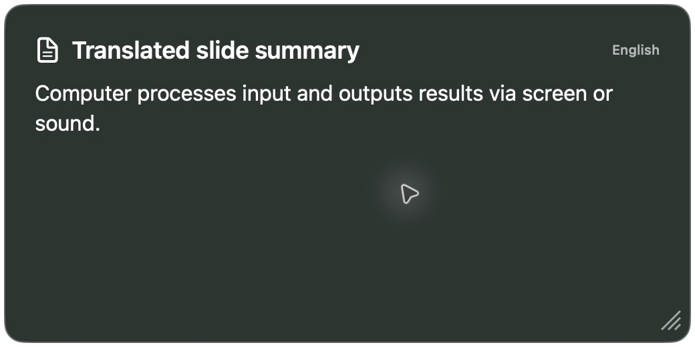

# Quillo（クイロ）

**日本語** | [English](README.en.md)

**授業の声を字幕に。スライドの内容を、短い翻訳付き要約に。**

PowerPoint・Keynote・Canvaなど、いつもの発表画面に重ねて使うMacアプリです。

## 作った理由

PowerPointの字幕翻訳は便利ですが、私の授業環境では、次の困りごとがありました。

- MacのPowerPointをウィンドウ再生すると、手元で発表者ノートを見られず、**自分が話す内容を確認しながら授業を進めにくい**。
- 話している内容に加えて、**スライドに書かれた内容も翻訳して届けたい**。

そこで、発表アプリとは別に字幕を表示し、スライドの内容も短い翻訳付き要約にするQuilloを作りました。スライドと発表者ノートは、普段の発表アプリで扱います。

## できること

- **話した内容を字幕にする** — 日本語・英語の音声に対応。話の途中から原文と翻訳を更新。
- **スライドを短く要約する** — 読み取る範囲を選び、別パネルに翻訳済みの要点を表示。選んだ枠は後から移動・サイズ調整でき、複数範囲は同じ番号で要約を分けます。
- **見やすい場所に置く** — パネルをドラッグで移動。大きさ・文字サイズ・背景も調整。
- **表示を切り替える** — 原文のみ／翻訳のみ／両方。日本語・英語・中国語の簡体字／繁体字に対応。
- **字幕の履歴を選べる** — 直前の1〜2文を薄く表示。設定でオン／オフを切り替え、文字サイズは自動調整。原文・翻訳とも対応し、スクロールは不要です。
- **入力文をAIで補正する（試用）** — 音声認識・文字入力の原文を補正し、その原文から翻訳。字幕は先に表示し、入力が落ち着くと文脈から誤字・文字抜けを補正します。設定でオンにでき、補正前後も比較できます。
- **授業の用語を登録する** — 資料ごとの辞書で、専門用語の認識・訳語を補助。

音声入力は**日本語・英語**。翻訳の表示先、資料の言語、文字入力は**日本語・英語・中国語（簡体字／繁体字）**に対応します。話す言語と資料の言語は別々に選べます。

## 動作画面

### 原文と英訳を表示

確認用の日本語を入力し、Appleの翻訳機能で英訳した実際の字幕パネルです。

### スライドの要点を英語で表示

サンプル資料の文字を読み取り、Mac内のAIで英語の要約を生成した実際のパネルです。

*画像は開発中の動作確認記録です。字幕の画像は文字入力による確認で、音声認識の精度・速度を示すものではありません。表示の細部は現在の版と異なる場合があります。*

## 始め方

**現在は試作版のソースコードを公開しています。** ダウンロードしてすぐ使える公証済みアプリは、まだ配布していません。[導入手順はこちら](docs/SETUP.md)。

- **必要なMac**：Apple Silicon（M1以降）／macOS 15以降。
- **字幕の準備**：マイク・音声認識の許可、話す言語の音声データ、翻訳用の言語データ。音声データの取得が終わるまで、その言語のマイク入力は使えません。
- **要約・字幕補正の準備**：Ollamaとローカルモデル `qwen3.5:9b`。通常の字幕翻訳だけならOllamaは不要。

1. **「言語の設定」**で、話す言語・資料の言語と、**学生に見せる言語**を選ぶ。学生に見せる言語は字幕の翻訳・資料の要約で共通。
2. 「**話して字幕を出す**」でマイクと字幕を開始する。メニューバーの吹き出し・設定画面からも同じ操作ができます。
3. 要約も使う場合は、**「資料の画面を選ぶ」→ 資料の部分を囲む**。
4. 「**設定**」で見た目や用語辞書を調整する。

**学生へ見せるときは、字幕・要約を含む「画面全体」を共有・投影してください。** 資料ウィンドウだけの共有には、別パネルは映りません。

## 知っておきたいこと

- 音声認識・翻訳・要約はMac内で処理します。初回の言語データ・モデルの取得にはネット接続が必要です。
- 字幕は現在の文と、設定に応じて直前の1〜2文を表示します。非常に長い文や小さいパネルでは末尾を表示し、全文はログに残します。資料の要約は範囲ごとにパネルに収まる長さへ調整します。
- 認識・翻訳・AI要約には誤りや遅延があります。教室での長時間利用や全画面表示は、利用環境での確認が必要です。
- 録音・録画は保存しません。字幕ログは、手動で保存しなければ終了時に消えます。

## 詳しく読む

- [使い方・困ったとき](docs/USER_GUIDE.md)
- [資料ごとの用語辞書](docs/GLOSSARIES.md)
- [動作確認の結果と未確認の範囲](docs/VALIDATION.md)
- [開発・更新を続ける方法](docs/MAINTENANCE.md) ／ [変更履歴](CHANGELOG.md)

[Hedwigとつくる道具 — シリーズ紹介](https://github.com/xhan21/hedwig-tools)

## 参考・ライセンス

- [commentable](https://github.com/TetsuakiBaba/commentable)：他のアプリに重ねる使い方とウィンドウ構成を参考にしました。Quilloは独立したSwift製アプリです。
- [class-material-translator](https://github.com/xhan21/class-material-translator)：別パネルの操作を参考にし、段組の読み順処理をSwiftへ移植しました。[著作権表示](Resources/ClassMaterialTranslator-LICENSE.txt)を同梱しています。
- ソースコードは[MITライセンス](LICENSE)。Appleの言語データとAIモデルは同梱していません。
